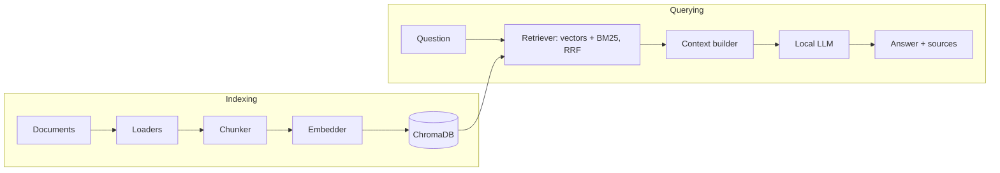

# Mini RAG

Chat with your own documents using locally running models. Documents (PDF, DOCX, TXT, Markdown)
are chunked, embedded with Ollama, stored in a persistent ChromaDB collection, and retrieved to
ground answers from a local LLM. Nothing leaves your machine: no external AI APIs, no telemetry
(ChromaDB's is disabled).

No RAG framework is used; the pipeline is implemented directly on `ollama`, `chromadb`,
`pymupdf`, `python-docx` and `prompt_toolkit`.

## Architecture



**Indexing:** Document → Loader → Chunker → Embeddings → Vector Database
**Querying:** Question → Hybrid Retrieval (query embedding + BM25, fused by RRF) → Context Construction → Local LLM → Answer

| Module | Responsibility |
|---|---|
| `config.py` | Defaults, `RAG_*` environment variables, validation |
| `models.py` | `Document`, `Chunk`, `RetrievedChunk`, `Source`, `Answer`, base error |
| `ingestion/loaders.py` | File discovery and text extraction (PDF pages keep page numbers) |
| `ingestion/chunker.py` | Paragraph/sentence-aware chunking with overlap |
| `embeddings.py` | `Embedder` protocol and the Ollama implementation (batched) |
| `evaluation.py` | Synthetic-question retrieval eval: question generation, hit-rate / MRR / NDCG |
| `vector_store.py` | ChromaDB persistence, cosine search, safe document replacement, model-compatibility check |
| `indexer.py` | Incremental indexing pipeline (load → chunk → embed → store) |
| `retriever.py` | Dense vector search, optionally fused with BM25 keyword search by Reciprocal Rank Fusion. No generation |
| `reranker.py` | Optional: rescores the top 10 candidates with the chat model (yes/no logprobs) |
| `keyword_index.py` | SQLite FTS5 (stdlib) BM25 index over chunk text, kept in step with ChromaDB by `vector_store.py` |
| `generator.py` | Ollama chat call with the system prompt |
| `rag.py` | Orchestration: retrieve, build `[S1]`-labelled context, generate, attribute sources |
| `interactive.py` | prompt_toolkit shell, answer formatting, spinner (presentation only) |
| `cli.py` | argparse dispatch and wiring |

Key behaviours:

- **Incremental indexing.** Each file gets a fingerprint (SHA-256 of its bytes plus the chunk
  size/overlap). Unchanged files are skipped; changed files are re-embedded and replaced. Chunk IDs
  contain the fingerprint, so replacement first *adds* the new chunks and only then deletes the
  old ones. If embedding fails, the previous version stays intact.
- **Embedding-model safety.** The embedding model name is stored on the collection. Using a
  different model without `--rebuild` fails with an explanation instead of mixing vectors.
- **Honest citations.** The sources shown to you are the chunks that were actually retrieved
  (`[S1]`, `[S2]`, ...), tracked outside the LLM. If the model cites an ID that was not retrieved,
  a warning is printed. If nothing is retrieved (empty index), the LLM is not called.
- **Chunk size is approximate.** Sizes are counted in characters at ~4 characters per token to
  avoid a tokenizer dependency. Real token counts vary with language and content.

## Prerequisites

- macOS/Linux with Python 3.14+ (uv will fetch one if needed)
- [uv](https://docs.astral.sh/uv/)
- [Ollama](https://ollama.com/)

### Install uv

```bash
brew install uv          # or: curl -LsSf https://astral.sh/uv/install.sh | sh
```

### Install Ollama and models

Install from <https://ollama.com/download> (or `brew install ollama`), start it
(`ollama serve`, or the desktop app), then:

```bash
ollama pull qwen3.5:9b-mlx
ollama pull nomic-embed-text-v2-moe
```

## Setup

```bash
uv sync
uv run mini-rag --help
```

### Dependency management

```bash
uv add <package>          # runtime dependency
uv add --dev <package>    # development dependency
uv sync                   # install from uv.lock
```

## Configuration

Settings come from defaults, then environment variables (a `.env` file in the working directory is
loaded; see [.env.example](.env.example)), then CLI options.

| Variable | Default | CLI option |
|---|---|---|
| `RAG_LLM_MODEL` | `qwen3.5:9b-mlx` | `--model` (ask, chat) |
| `RAG_EMBEDDING_MODEL` | `nomic-embed-text-v2-moe` | `--embedding-model` |
| `RAG_OLLAMA_HOST` | `http://localhost:11434` | `--ollama-host` |
| `RAG_CHUNK_SIZE` | `400` | `--chunk-size` (index) |
| `RAG_CHUNK_OVERLAP` | `60` | `--chunk-overlap` (index) |
| `RAG_TOP_K` | `5` | `--top-k` (ask, chat) |
| `RAG_RETRIEVAL` | `hybrid` | `--retrieval dense\|hybrid` (ask, chat, eval) |
| `RAG_RERANK` | `false` | `--rerank` / `--no-rerank` (ask, chat, eval) |
| `RAG_NUM_CTX` | `8192` | |
| `RAG_VECTOR_DB_PATH` | `./storage/chroma` | `--db-path` |
| `RAG_COLLECTION_NAME` | `documents` | `--collection` |
| `RAG_HISTORY_PATH` | `./storage/chat_history` | |
| `RAG_SYSTEM_PROMPT` | built-in grounded-QA prompt | |

Invalid values (non-positive sizes, overlap ≥ size, non-integers) are rejected at startup.

`RAG_NUM_CTX` is passed to Ollama as the context window for generation. Ollama's own default is
small enough that five 400-token chunks plus the question could be silently truncated.

> **Note on chunk size:** `nomic-embed-text-v2-moe` accepts at most 512 tokens, so the default of
> 400 (approximate) tokens leaves headroom. Sizes are estimated at ~4 characters per token; for
> non-English or code-heavy text the real token count can be higher, so lower `RAG_CHUNK_SIZE` if
> you see weak retrieval. Changing chunk settings re-indexes files automatically.

### System prompt

The default prompt lives in `config.py` (`DEFAULT_SYSTEM_PROMPT`); override it with
`RAG_SYSTEM_PROMPT`. It is built on common guidance for grounded RAG:

- Answer only from the supplied documents, and give the model explicit permission (and a fixed
  sentence) to decline when the answer is absent ([Anthropic: reduce hallucinations][halluc]).
- Cite a source ID after each claim, and never invent IDs, pages or quotes. The app independently
  checks citations against what was actually retrieved.
- Answer the supported part of a partly answerable question and say what is missing; flag
  contradictions between sources.
- Treat document text as data, not instructions, to blunt indirect prompt injection from
  indexed files. This helps but does not fully prevent it
  ([Rag and Roll, arXiv 2408.05025][ragroll]).
- The user message puts the documents first as `<document id="S1"><source>...</source>
  <document_content>...</document_content></document>` blocks and the question last
  ([Anthropic: long-context tips][longctx]).

If you replace the prompt, keep it consistent with that context format and with the `[S1]`
citation style, which `rag.py` parses to detect citations that match no retrieved source.

[halluc]: https://platform.claude.com/docs/en/test-and-evaluate/strengthen-guardrails/reduce-hallucinations
[longctx]: https://platform.claude.com/docs/en/build-with-claude/prompt-engineering/claude-prompting-best-practices#long-context-prompting
[ragroll]: https://arxiv.org/pdf/2408.05025

## Usage

### Retrieval modes

`hybrid` (default) runs dense vector search and BM25 keyword search, then merges the two ranked
lists with Reciprocal Rank Fusion (k=60), taking `max(4 * top_k, 20)` candidates from each. It helps
with exact terms (identifiers, error codes, names, numbers) that embeddings blur. `dense` is vectors
only. The keyword index is a SQLite FTS5 file (`keywords.sqlite3`, next to the ChromaDB data) that is
derived from ChromaDB: if the two ever disagree (for example on the first run after upgrading), it is
rebuilt automatically. With `--source`, hybrid search supports string equality filters on `source`
only. Measured effect: see PLAN.md.

### Optional reranking

`--rerank` (or `RAG_RERANK=true`) rescores the top 10 retrieved chunks with the chat model before
taking the top `k`. Ollama has no rerank API, so each candidate costs one LLM call (about a second
each, roughly 10 s extra per question). It is **off by default** because the measured benefit was
inconsistent: it helped on a larger, harder corpus and hurt on a small one where hybrid was already
strong (details in PLAN.md). Use `mini-rag eval ... --rerank` on your own documents before enabling it.

### Index documents

```bash
uv run mini-rag index ./documents
uv run mini-rag index ./documents --rebuild    # drop the collection and re-index
uv run mini-rag index ./documents --prune      # also drop documents whose files were deleted
```

Discovers `.pdf`, `.docx`, `.txt`, `.md`/`.markdown` files recursively (hidden files and Word lock
files are skipped), then prints a summary. Corrupted or empty files, and PDFs with no text layer
(scanned; no OCR), are reported under `Files failed` without stopping the run; the exit code is 1 if
any file failed. A problem with Ollama itself (not running, model missing) aborts the run with
instructions.

### Ask one question

```bash
uv run mini-rag ask "Explain supervised learning."
uv run mini-rag ask "Explain neural networks." --top-k 8
uv run mini-rag ask "What does chapter 2 say?" --source guide.pdf   # restrict to one file
```

### Measure retrieval quality

```bash
uv run mini-rag eval questions.jsonl --generate 100   # once: a local LLM writes one question per sampled chunk
uv run mini-rag eval questions.jsonl                  # score the current retriever (k=10 by default)
```

Each generated question is paired with the chunk it came from, which counts as the single correct
result. The report gives chunk hit@1/3/5/k, MRR, NDCG, and whether the right *document* was found.
Keep the question file frozen (generation refuses to overwrite without `--force`) and re-score
after each retrieval change; the numbers are only meaningful relative to each other. Questions are
tied to chunk IDs, so regenerate them if you change chunk size or the documents change. Generated
questions tend to share vocabulary with their chunk, which flatters keyword-style matching.
Recipe adapted from the [hybrid-retrieval cookbook](https://github.com/daveebbelaar/ai-cookbook/blob/main/knowledge/hybrid-retrieval/docs/build-your-own-eval.md).

### Interactive chat

```bash
uv run mini-rag chat
```

Each question is answered independently (there is no conversation memory).

| Command | Description |
|---|---|
| `/help` | Show commands and keys |
| `/status` | Model, database and index status |
| `/clear` | Clear the screen |
| `/exit`, `/quit` | Leave (also Ctrl+D) |

| Key | Action |
|---|---|
| Enter | Send |
| Alt+Enter / Ctrl+J | Newline (pasted multi-line text is kept) |
| Up / Down, Ctrl+R | History browse / search (persisted in `RAG_HISTORY_PATH`) |
| Ctrl+C | Cancel the current input, or a running answer |
| Ctrl+D | Exit |

## Project structure

```text
src/mini_rag/
  cli.py  interactive.py  config.py  models.py
  indexer.py  retriever.py  generator.py  rag.py
  embeddings.py  vector_store.py  ollama_utils.py
  ingestion/  loaders.py  chunker.py
tests/
  unit/  integration/  conftest.py
```

## Development

```bash
uv run pytest                 # no Ollama required (live tests are deselected)
uv run pytest -m live         # live end-to-end tests; needs Ollama + the default models (~2 min)
uv run pytest --cov=mini_rag
uv run ruff check .
uv run ruff format .
uv run mypy src/
```

`tests/e2e` runs the real pipeline against Ollama (all four formats, citations, refusal, and
Ctrl+C during generation in a pty); it skips itself if Ollama or the models are missing.
Other tests mock Ollama; integration tests use temporary ChromaDB directories and a deterministic fake
embedder.

## Troubleshooting

| Symptom | Fix |
|---|---|
| `Cannot connect to Ollama` | Start Ollama (`ollama serve`) or fix `RAG_OLLAMA_HOST` |
| `model ... is not available` | `ollama pull <model>` |
| `was built with embedding model ...` | You changed the embedding model; re-run `index --rebuild` |
| `no extractable text` for a PDF | It is likely scanned images; OCR is not supported |
| Answers say nothing was found | Run `index` first, check `/status` shows chunks, try a larger `--top-k` |
| Slow first answer | The model is loading into memory; thinking models also reason before replying |

## Known limitations

- `--prune` only removes documents under the directory you pass, and only if they were indexed after paths started being recorded; older ones are reported and need `--rebuild`. It refuses to run if no supported files are found under the directory, so an empty or unmounted folder cannot wipe the index.
- Document identity is the absolute file path; moving a folder re-indexes it (old chunks remain until a rebuild).
- Retrieval is pure vector search (no reranking or hybrid search) and there is no multi-turn memory, by design.
